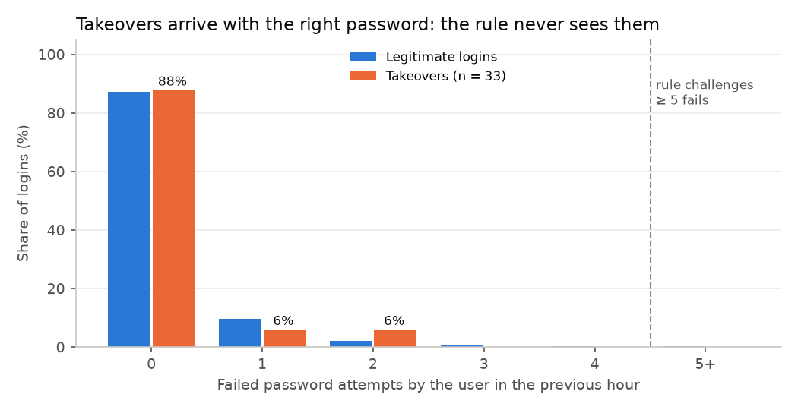
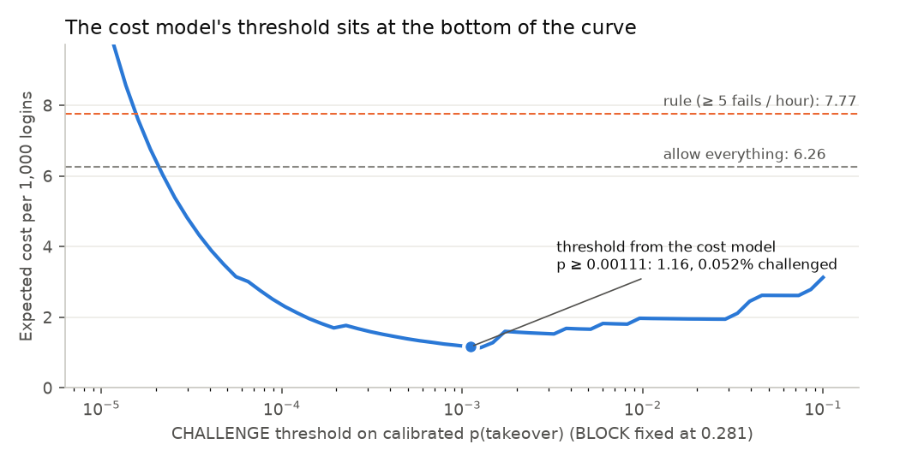

# De-Riddled: catching account takeovers that rules can't see

**On 2.6 million held-out logins, De-Riddled stopped 28 of 33 account takeovers while challenging 0.05% of legitimate users. At the same friction that is 39 points more than the best non-ML baseline (95% CI 18–59). The bank's standard rule stopped none.**

Live demo: https://tazerflash-deriddled.streamlit.app/ · Project page: https://tazerflash.github.io/DeRiddled-ATO-Detection-Engine/

These are validation results. The model and its thresholds were chosen on this window, so they are optimistic; a final test window (Oct–Nov 2020, 22 takeovers) is still untouched.

---

## 1. The problem, and why rules fail

An **account takeover (ATO)** is someone logging in to your account with your real password, bought from a breach or phished. The standard defence is a rule such as "challenge the login after 5 failed attempts in an hour". It's simple, explainable, and it catches people who guess passwords.

It doesn't catch people who *know* the password:

In the validation window, 29 of the 33 takeovers had **zero** failed attempts in the previous hour, and none had more than two. The rule fires at five, so it challenged 0.30% of real users (mostly people who mistype) and stopped **no takeovers**. Counting the friction it adds, the rule costs more than doing nothing at all (7.77 vs 6.26 per 1,000 logins, section 5).

The signal is elsewhere: a login from a new country, a new network and a new device at once; a rare ISP; a network with takeover history. De-Riddled turns that into a calibrated probability, and then into **ALLOW**, **CHALLENGE** (one-time code) or **BLOCK**, with the top three reasons in plain English.

---

## 2. Data, and the leakage trap

**Dataset.** The public [RBA dataset](https://github.com/das-group/rba-dataset) (Wiefling et al., CC BY 4.0) has 31.27 million logins by 4.3 million users over 13 months, simulated from a large Norwegian online service.
- **Takeovers are extremely rare:** 141 labelled rows on 138 users.
- **One campaign dominates:** 79 of the 141 come from a single Romanian campaign with one browser fingerprint. Every result is reported for the campaign and for "other" separately, so the model can't look good just by learning one fingerprint.
- **Fake accounts:** five IDs behave like non-accounts. Each has more than 1,000 logins with under 1% success; the largest holds 45% of all rows. They're flagged and excluded from per-user features.

**Point-in-time features.** Every one of the 44 features (39 in the final model) uses only information that existed *before* that login. Velocity, novelty, population frequency, IP and subnet activity, a likelihood-ratio score, and network reputation are all written in DuckDB SQL over Parquet.
- **The tie rule:** two logins at the same timestamp must not see each other, so every window ends with `EXCLUDE GROUP`, not `EXCLUDE CURRENT ROW`.
- **The leakage test:** recomputes a random sample of rows from raw history, independently of the SQL, and must match exactly. It caught a real bug: `SUM` over an empty window returns NULL, not 0.

**Delayed labels.** In reality a takeover is confirmed days later, when the victim complains. The reputation features ("how many confirmed takeovers has this network had?") only count takeovers confirmed **at least 7 days earlier**. A delay test (1, 7, 14 and 30 days) showed the results barely move: 29, 28, 28 and 27 stopped.

**Time-based splits.** Train Feb–Jul 2020, validate Aug–Sep, test Oct–Nov. Takeover labels stop on 23 Nov 2020, so later months are *unlabelled*, not "clean", and are never used as negatives.

---

## 3. From baseline to model: what actually helps

Each feature family was added one at a time to the same XGBoost model (depth 3). Results are takeovers caught when challenging the riskiest 1% of logins on validation:

| Step | Takeovers @ 1% | Non-campaign @ 1% |
| --- | --- | --- |
| Static rule | 0 / 33 | 0 / 14 |
| Likelihood ratio (Freeman et al., NDSS 2016) alone | 22 / 33 | 8 / 14 |
| User behaviour (19 features) | 23 / 33 | 9 / 14 |
| + population frequencies | 30 / 33 | 11 / 14 |
| + IP–account graph | 30 / 33 | 11 / 14 |
| + likelihood score as a feature | 30 / 33 | 11 / 14 |
| + Isolation Forest anomaly score | 30 / 33 | 11 / 14 |
| + delayed network / IP takeover reputation | 32 / 33 | 13 / 14 |
| **Final model (no country features, monotone reputation)** | **33 / 33** | **14 / 14** |

What the ablation taught:
- **Population and reputation do the work.** The graph features matter a lot for a different target, *credential-stuffing IPs* (+29 points there), but not for takeovers. The infrastructure that tests stolen passwords at scale is not the infrastructure that uses them.
- **The anomaly detector adds nothing.** Most anomalies are travellers and new phones. Its apparent +9 points on the stuffing target turned out to be seed noise once I ran three seeds.
- **Two corrections after the ablation:**
  - *Country features removed.* "Takeovers from this country so far" made the model treat every Romanian as a suspect: the error analysis found genuine Romanian users challenged at 131× the average rate. Dropping the country features cut genuine Romanian friction from 4.0% to 1.0% and kept every takeover in the top 1%.
  - *Monotone constraints* on the six network / IP takeover-history features (section 6).
  - *Novelty against successful logins only*, after a red team found that attackers' own failed guesses made them look familiar (section 7).

---

## 4. Choosing thresholds: a cost model, not a guess

The probability is calibrated: a sigmoid fit with temporal cross-fitting, so the expected number of takeovers matches the observed 33 to within a few. The two thresholds then come from the costs of each outcome, not from tuning:
- missed takeover: 500
- one-time code shown to a real user: 0.5
- real user wrongly blocked: 20
- share of attackers a one-time code stops: 90%

**CHALLENGE** when the expected loss saved exceeds the friction, which gives p ≥ 0.00111. **BLOCK** when blocking beats challenging, which gives p ≥ 0.281.

For the previous champion (D, shown in the figure), the threshold derived from costs, before looking at outcomes, gave 1.16 per 1,000 logins against an empirical minimum of 1.14. Halving or doubling any single cost moved the policy's cost to between 0.94 and 2.02, always far below allowing everything (3.13–12.53 in the same scenarios). The current champion E was recalibrated the same way; its thresholds are the same (p ≥ 0.00111 and p ≥ 0.281) and its cost is 1.66.

---

## 5. Shadow-mode experiment: design, power, result

**Design.** A bank would never switch fraud systems on faith, so the rule (control) and De-Riddled (treatment) both decide **every** validation login. That makes the comparison paired: same attacks, same users. A third policy, the likelihood ratio, gets **exactly the model's challenge budget**, so "catches more" can't just mean "challenges more".

| Policy | Legit users challenged | Takeovers stopped (campaign / other) | Cost per 1,000 logins |
| --- | --- | --- | --- |
| Allow everything | 0 | 0 / 33 | 6.26 |
| Rule (≥ 5 fails / hour) | 0.30% | 0 / 33 | 7.77 |
| Likelihood ratio, same budget | 0.052% | 15 / 33 (8 / 7) | 3.96 |
| **De-Riddled** | **0.051%** | **28 / 33 (19 / 9)** | **1.66** |

At this operating point recall is 84.8% and precision 2.0% (28 of 1,382 flagged logins), about 1,600× the 0.00125% base rate. The BLOCK tier is 37.5% precise, and 29 of its 32 blocks are takeovers or known attack IPs. PR-AUC is 0.341, against 0.009 for the likelihood ratio.

**Significance.** McNemar's exact test uses only the disagreements.
- **Against the likelihood ratio:** the model alone stops 14 takeovers and the baseline alone stops 1, p = 0.001.
- **Legitimate friction:** indistinguishable from the baseline (p = 0.80), as designed.

**Effect size.** The bootstrap resamples whole days, not single logins, because campaigns arrive in bursts. Against the likelihood ratio, recall rises **+39 points [18, 59]** and cost falls 2.30 per 1,000 logins [0.86, 3.99]. Against the rule, recall rises +85 points and real-user friction is 6× lower.

**Power, computed before touching the test window.**
- **Against the rule:** with exact McNemar power, 8 takeovers already give 80% power.
- **Against the likelihood ratio:** the test window's 22 takeovers give 80% power only if the +39-point gap is real. Because the model was selected on validation, that gap is probably inflated (the winner's curse). At a true +25 points, power drops to 38%.
- **The plan:** pre-register the required number of takeovers, and treat a non-significant result against the baseline as inconclusive, not as a failure.

---

## 6. Two things I found by building the rest of the system

**A model that punished feedback.** I built an analyst dashboard (Streamlit) with an alert queue, a case view with reasons and a map of the user's past countries, and label buttons. I then simulated analysts confirming three takeovers. Every other alert on those networks got a **lower** score. A probe showed why:

| Earlier takeovers on the network | 0 | 1 | 2 | 3 | 5+ |
| --- | --- | --- | --- | --- | --- |
| p(takeover), previous model | 0.022 | 0.137 | 0.137 | 0.106 | 0.098 |

With 86 training takeovers, networks with many past takeovers were mostly big ISPs, so the model learned "more takeover history → slightly safer". The fix was XGBoost monotone constraints on the six takeover-history features, which guarantee the score can never fall as history rises. Across three seeds the constrained model was *better* every time (31 / 29 / 31 stopped vs 30 / 28 / 30), and the share of logins showing the backwards response fell from up to 100% to 0%. Offline metrics never revealed this; an interactive tool did.

**A model that couldn't be rebuilt.** Refitting the old champion with the same seed gave a different model. DuckDB reads Parquet in parallel, so rows arrived in a different order each run, and XGBoost's row subsampling picks rows by position. Adding `ORDER BY login_id` made training bit-for-bit reproducible. It also explained an earlier one-takeover "noise" difference between two models.

---

## 7. A blind spot no historical data could show

I had an LLM (Claude Sonnet) write five attack campaigns as simulator settings: credential stuffing from attack-listed networks, rented servers abroad at night, residential proxies, and attackers copying the victim's own ISP and device. A deterministic generator turned them into synthetic logins on real accounts, injected among two real validation days and scored by the same online code the API runs.

The champion at the time (D, 31 of 33 real takeovers) stopped **2 of 300** synthetic ones. The cause: "new country / network / device for this account" counted *every* earlier attempt, so an attacker's own failed guesses made their location familiar by the time the password worked. The real takeovers almost never fail first, so the historical data could not reveal it.

The fix measures novelty and the likelihood score against **successful** logins only. Synthetic takeovers stopped rose to **78–100 of 300** across two seeds. On the real validation takeovers it stops 28 instead of 31 (mean over three seeds 28.7 vs 30.3), at the same friction, and expected cost rises from 1.16 to 1.66 per 1,000 logins. I adopted it anyway, because a model any attacker can beat by failing once is not robust. Attackers who copy the victim's country, network and device remain undetectable from login metadata alone.

---

## 8. Serving it

The 39 features were reimplemented as an in-memory stream (`state.py`) behind a FastAPI `/score` endpoint.
- **Parity:** a test proves the streamed features identical to the SQL ones on about 382,000 values, after a float-precision bug forced integer-microsecond timestamps. A second test proves the API's decisions identical to the offline policy.
- **Fail-open:** if scoring takes longer than 200 ms, the login is allowed and logged, so users are never locked out by an outage.
- **Throughput:** a full week of validation traffic (503,676 logins) replayed through the API ran at **349 logins/s on one process, p95 5.3 ms end to end (2.3 ms scoring), zero fail-opens**, with decisions identical to the offline policy on all 307,562 real-account logins.
- **Two bottlenecks fixed on the way:**
  - building a one-row DataFrame cost 21 ms per request, fixed with NumPy and `inplace_predict`, verified identical;
  - Python's garbage collector was pausing on 2 GB of state, fixed with `gc.freeze()` after warm start.

Around it: an MLflow registry with a champion alias (rollback means moving the alias), PSI drift monitoring that alerts on the score rather than on noisy features, and the analyst dashboard.

---

## 9. The GenAI layer: explain, answer, attack, never decide

The calibrated model makes every ALLOW / CHALLENGE / BLOCK decision. Language models sit around it, and account IDs and IPs are salted-hashed before anything leaves the machine.
- **Case narrator (Claude Haiku).** Turns each alert's evidence into 4–6 claims that cite evidence IDs, plus a suggested next step. Code removes any claim whose numbers aren't in the evidence it cites. Prompt versions were compared on the same alerts with blinded AI judges and a paired bootstrap. v5, on 56 alerts no prompt was tuned on, scored 93.4% strict / 100% lenient faithfulness with 0 unsupported claims, at about $1 per 1,000 alerts. A human spot-check of the judge is still pending.
- **"Ask the Watchtower" SQL agent (Claude Haiku).** Answers analysts' questions with SQL over a hashed, read-only database: a single SELECT, a 30 s timeout and a 200-row cap. Scored by comparing result tables, not SQL text: 27/30 before tuning, then 30/30 on the tuned set and 9–10/10 on held-out questions.
- **Red team (Claude Sonnet).** Section 7.

---

## 10. Limits, and what I'd do with real production data

- **Simulated data and few labels.** 141 takeovers in total, 33 in validation; every interval is wide. Real data would need far more positives before any claim narrower than "much better than the rule".
- **Unlabelled is not legitimate.** In error analysis, most of the model's false BLOCKs carried the Romanian campaign's exact fingerprint. They may be attacker sessions that were never labelled, which would make precision look worse than it is. With production data I'd sample alerts for manual review to estimate the true label rate.
- **One campaign dominates.** 19 of the 33 validation takeovers share a fingerprint. Non-campaign recall (9 of 14 stopped) is the more honest number.
- **Validation was used for choices.** The model, the constraints, the red-team fix and the calibration were all chosen there. The test window is the real check, and its sample size is pre-registered.
- **With a real bank:**
  - run shadow mode until the pre-registered number of takeovers;
  - use rolling-origin evaluation over many months;
  - collect label-delay statistics from actual chargebacks;
  - A/B test the friction separately (does a one-time code make users leave?);
  - retrain monthly with a champion–challenger gate.
- **What I'd do differently:**
  - Constrain risk features from the start, rather than finding the problem late.
  - Make data order deterministic on day one.
  - Build the analyst dashboard earlier. It found the most important model defect of the project.
  - Red-team the features before trusting validation numbers. Historical data only contains the attacks that already happened.

---

*Stack: Python 3.11, DuckDB + Parquet, XGBoost, scikit-learn, SHAP, FastAPI, SQLite (WAL), MLflow, Streamlit, Plotly, Claude API (Haiku, Sonnet) with Pydantic-validated structured output. Data: Login Data Set for Risk-Based Authentication, Wiefling et al., CC BY 4.0.*
